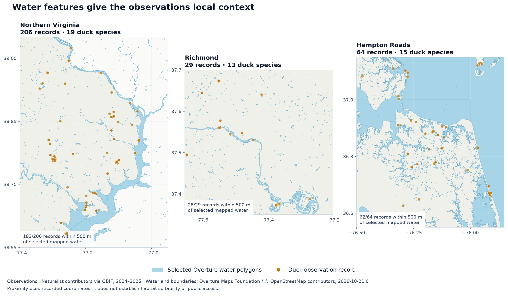

# vgi-ducks

Duck species, recent sightings, birding hotspots, and spatial migration patterns
as SQL tables in DuckDB. Written in TypeScript using the Query Farm VGI starter.

| SQL interface | Purpose |
| --- | --- |
| `ducks.main.species` | Offline eBird 2026 reference: 140 duck species, including 9 flagged extinct taxa |
| `ducks.main.recent_sightings(latitude, longitude, ...)` | Latest nearby observation per duck species, or per location for a selected species |
| `ducks.main.nearby_hotspots(latitude, longitude, ...)` | Nearby birding locations, with distances and all-bird reporting history |
| `ducks.main.seasonal_ranges(species_code, ...)` | Modeled seasonal range polygons as WGS84 WKB for spatial joins |
| `ducks.main.weekly_abundance(species_code, region_wkt, ...)` | Weekly modeled relative abundance within a polygon, with coverage counts |
| `ducks.main.migration_calendar(species_code, region_wkt, ...)` | All weeks tied for the highest positive regional mean abundance |

## See the queries and charts

[Open Ducks in Virginia](notebooks/spatial-migration.ipynb) for five saved charts:
observation locations, species counts, monthly reporting patterns, modeled weekly
abundance, and water-feature maps for Northern Virginia, Richmond, and Hampton
Roads. Analytical SQL and tables remain visible; setup and plotting cells are
omitted from this GitHub reader.



The notebook combines the published `v0.1.0` duck worker with the local TypeScript
[Overture worker](https://github.com/Query-farm/vgi-overture-maps-typescript), pinned
to Overture release `2026-10-21.0`. The saved run contains 580 Virginia observation
records across 29 duck species from iNaturalist/GBIF in 2024–2025. Separately,
authenticated eBird Status and Trends products supply the 2023 annual cycles and
seasonal ranges of Wood Duck, Bufflehead, and Blue-winged Teal. Reporting counts,
modeled relative abundance, and water proximity have distinct interpretations;
the notebook explains each.

Viewing the saved notebook needs no key. To regenerate it, configure your own
`EBIRDST_KEY` in the environment, install the Overture checkout beside this repo
with `bun install --frozen-lockfile`, and run `make notebook`. Set
`VGI_OVERTURE_REPO` for another checkout location. The
[complete executable source](notebooks/virginia-ducks.source.ipynb) includes
collapsed setup cells and JupyterLab instructions. Python handles Jupyter,
public GBIF retrieval, and plotting; analysis runs in SQL and both VGI workers
remain TypeScript. Raw observations are cached locally in ignored `.cache/`;
credentials and source eBird rasters are not saved in the repository.

## Quick start

Standalone executables are available on the [GitHub releases page](https://github.com/Query-farm/vgi-ducks/releases).
Download the archive for your platform and extract it. No Bun installation is
needed for the executable; use its absolute path as the VGI `LOCATION` below.
Releases include SHA256 checksums, Sigstore signatures and build provenance.

For a source checkout:

Requires Bun 1.3+ and DuckDB 2.0.0. Development checks also require `make`, Python
and [uv](https://docs.astral.sh/uv/).

```sh
make build
uvx --from duckdb-cli==2.0.0 duckdb
```

```sql
SET allow_extension_repositories = 'allowed';
CREATE EXTENSION REPOSITORY IF NOT EXISTS query_farm
    WITH PREFIX 'https://duckdb-extensions.query.farm';
INSTALL vgi FROM query_farm;
LOAD vgi FROM query_farm;

-- Use the absolute path to your checkout.
ATTACH 'ducks' (
    TYPE vgi,
    LOCATION '/absolute/path/vgi-ducks/bin/vgi-ducks-worker'
);

-- Works offline and without a key.
SELECT species_code, common_name, scientific_name
FROM ducks.main.species
WHERE genus = 'Aix' AND NOT extinct
ORDER BY common_name;
```

To query sightings or hotspots, obtain your own [eBird API key](https://ebird.org/api/keygen).
After attaching the worker, create a session secret:

```sql
CREATE SECRET my_ebird (TYPE ebird, TOKEN 'your-personal-key');

SELECT common_name, observed_at_local, reported_count, location_name
FROM ducks.main.recent_sightings(42.36, -71.06)
ORDER BY common_name;

-- Look up the current code in the species table: Mallard is mallar3 in 2026.
-- A species-specific search returns its latest sighting at EACH location.
SELECT location_name, reported_count, observed_at_local, distance_km
FROM ducks.main.recent_sightings(
    42.36, -71.06, species_code := 'mallar3', days_back := 7
)
ORDER BY distance_km, location_name;

SELECT location_name, distance_km, all_bird_species_count
FROM ducks.main.nearby_hotspots(42.36, -71.06)
ORDER BY distance_km, location_name
LIMIT 5;
```

Alternatively, set `EBIRD_API_KEY` in the environment **before starting DuckDB or
the worker**. A nonempty `ebird` secret takes precedence over that variable.
The sightings API credential stays in request headers, never serialized
table-function state. Sightings requests do not follow API redirects or include
response bodies in errors.

[demo.sql](demo.sql) contains runnable queries from the project directory. Its
API section needs `EBIRD_API_KEY`; its first species query does not.

## Spatial migration patterns

These functions read [eBird Status and Trends](https://ebird.github.io/ebirdst/articles/status.html)
seasonal GeoPackages and weekly GeoTIFFs directly in TypeScript. The worker needs
no R, Python or GDAL runtime. DuckDB Spatial converts the returned ordinary WKB
into geometry for joins with wetlands, refuges, counties, or your own locations.

Try the real public sample without an access key after attaching the worker:

```sql
INSTALL spatial FROM core;
LOAD spatial;
SET geometry_always_xy = true;

SELECT season, start_date, end_date, wraps_year
FROM ducks.main.seasonal_ranges('yebsap-example')
WHERE ST_Intersects(ST_GeomFromWKB(geometry_wkb), ST_Point(-85, 45))
ORDER BY season;

SELECT week_date, mean_relative_abundance, coverage_fraction
FROM ducks.main.weekly_abundance(
  'yebsap-example', 'POLYGON((-90 41,-82 41,-82 49,-90 49,-90 41))'
)
ORDER BY week_date;

SELECT week_date, mean_relative_abundance, modeled_cell_count, coverage_fraction
FROM ducks.main.migration_calendar(
  'yebsap-example', 'POLYGON((-90 41,-82 41,-82 49,-90 49,-90 41))'
)
ORDER BY week_date;
```

**The public sample is Yellow-bellied Sapsucker data restricted to Michigan, not
duck data.** It uses Cornell's [example dataset](https://github.com/ebird/ebirdst_example-data),
pinned at commit `a3ab944f505ad6f583e0c830d5e951929446e9eb`, and supports only
`data_year := 2023, resolution := '27km'`. It exercises the same readers as duck
products. The sample region above peaks on `2023-04-19`.

For duck products, obtain a separate [Status and Trends access key](https://ebird.org/st/request)
and create a session secret after attaching:

```sql
CREATE SECRET my_status (TYPE ebirdst, TOKEN 'your-status-access-key');
```

Alternatively set `EBIRDST_KEY` before starting DuckDB or the worker. A nonempty
`ebirdst` secret takes precedence. `EBIRD_API_KEY` is a different credential.
Use a species code available in the selected model release; the 2026 taxonomy
table does not establish the codes or coverage in a 2023 model. Unavailable
products fail clearly. There is no silent taxonomy remapping. The reader also
accepts other modeled birds, which makes mixed-species spatial comparisons possible.

```text
seasonal_ranges(species_code VARCHAR,
  data_year := 2023, resolution := '27km', season := '')
weekly_abundance(species_code VARCHAR, region_wkt VARCHAR,
  data_year := 2023, resolution := '27km')
migration_calendar(species_code VARCHAR, region_wkt VARCHAR,
  data_year := 2023, resolution := '27km')
```

- `data_year` selects a model release/prediction year; 2023 is the verified
  format and explicit default. These are modeled seasonal distributions, not
  individual migration tracks or a live migration forecast.
- Seasonal ranges support `27km` and `9km`. `season` optionally selects
  `breeding`, `nonbreeding`, `prebreeding_migration`, `postbreeding_migration` or
  `resident`. The empty string returns all available seasons. Original season
  dates are preserved; `wraps_year` identifies winters crossing New Year.
- Geometry is WGS84 (EPSG:4326), x = longitude, y = latitude. Weekly region
  inputs accept 2D Polygon/MultiPolygon WKT with holes and disjoint parts.
  Use `ST_AsText` on your geometry after transforming it to WGS84. Split regions
  crossing the antimeridian into separate queries. Simplify to at most 2,000
  vertices; rings must have nonzero area and must not cross or touch one another.
- Weekly grids support `27km`, `9km` and `3km` when the upstream product exists.
  The worker transforms native Equal Earth (EPSG:8857) cell centers to WGS84 and
  selects centers strictly inside your polygon, excluding its holes and boundary.
  Equal-area cells have equal weight. This is a center-based regional summary,
  not an exact area-clipped mean. There is no interpolation or upsampling.
- Relative abundance is the expected number of birds on a standardized
  one-hour, two-kilometer checklist under the model's observation conditions.
  Regional means/maxima are not total populations. **True zero stays zero;
  NoData is excluded.** `modeled_cell_count / selected_cell_count` is
  `coverage_fraction`. No modeled cells yields NULL abundance; no selected
  centers yields NULL coverage. Coverage applies to cell centers within the
  raster extent, not to the fraction of the entire polygon's area covered.
- Original weekly dates are retained; available bands may be fewer than 52.
  Compare coverage before interpreting changes. `migration_calendar` returns
  all tied positive annual peak weeks, or no rows for an all-zero/missing series.
  A peak can reflect breeding or winter residence; it does not establish an
  arrival/departure date or prove that migration occurred that week.
- Each call downloads its source products; materialize results with `CREATE
  TEMP TABLE ... AS SELECT ...` for repeated analysis. Product downloads are
  bounded to 128 MiB, with 60-second request timeouts and bounded retries. Signed
  HTTPS download redirects are supported. Only a regional window is decoded,
  limited to 50,000 cells. Use a smaller region or coarser product if necessary.
  Large high-resolution products can exceed the download limit even for a small
  region. Credentials, signed URLs and file bytes are never placed in table
  state or diagnostics; the Status API requires its key in a request query parameter.

For a polygon-to-polygon join, materialize seasonal ranges once, then join
`ST_GeomFromWKB(r.geometry_wkb)` to a wetlands table using `ST_Intersects`.
[migration-demo.sql](migration-demo.sql) is a complete, key-free example with
a sample wetland, weekly summaries and the peak calendar.

## Parameters and semantics

```text
recent_sightings(
  latitude DOUBLE, longitude DOUBLE,
  radius_km := 25, days_back := 14, species_code := '',
  hotspots_only := false, include_provisional := false
)
nearby_hotspots(
  latitude DOUBLE, longitude DOUBLE,
  radius_km := 25, days_back := 0
)
```

- WGS84 coordinates: latitude −90 to 90, longitude −180 to 180. The API search
  center is rounded to two decimal places as documented by eBird; `distance_km`
  is a great-circle distance from that rounded center, not a driving distance.
- Radius is 0–50 km for both functions. Sighting lookback is 1–30 days.
  Hotspot `days_back := 0` omits the recency filter; 1–30 restricts recent visits.
- **An empty `species_code` returns the latest sighting per species across the
  search area. A selected species returns the latest sighting per location.**
  Neither is a full checklist history. The API does not paginate these endpoints.
- Species searches use extant members of the bundled catalog. Geese, swans,
  domestic forms, hybrids and unidentified groups are excluded; Nettapus
  pygmy-geese are included as ducks. See [data provenance](data/README.md) for
  the exact scope and refresh procedure. An unknown or extinct code is an error.
- `observed_at_local` and `latest_observation_local` preserve eBird's original
  `YYYY-MM-DD` or `YYYY-MM-DD HH:MM` text. No UTC offset is supplied, so these
  values are **not** labeled UTC or converted to a fabricated timestamp.
  `fetched_at` is the retrieval time as `TIMESTAMPTZ` in UTC.
- `reported_count` is an INTEGER; absent/uncounted values are SQL NULL, while
  actual zero stays zero. Counts and repeated sightings are not population
  estimates. Review, validity and location-privacy flags are preserved separately.
- Hotspots describe locations for **all birds**. Their `all_bird_species_count`
  is an all-time count of bird species, not ducks or individuals. A hotspot name
  can include access restrictions. Join sightings on `location_id` for evidence
  that a duck was reported there.
- Explicit NULL arguments are rejected. Missing optional response fields become
  SQL NULL. Malformed data and upstream errors fail the query rather than becoming
  empty results. True empty API arrays yield empty tables with the declared schema.
- Calls use 20-second request timeouts, at most four attempts, and bounded backoff
  for network errors, HTTP 429 and 5xx. `Retry-After` seconds and HTTP dates are
  honored; delays exceeding 30 seconds fail clearly. Responses are capped at
  8 MiB, and reaching 10,000 records fails to avoid silently truncated results.
  No persistent sightings cache is used.

To combine the sources without implying that every hotspot has ducks:

```sql
SELECT s.common_name, s.observed_at_local, h.location_name, h.distance_km
FROM ducks.main.recent_sightings(42.36, -71.06) AS s
JOIN ducks.main.nearby_hotspots(42.36, -71.06) AS h USING (location_id)
ORDER BY s.common_name, h.location_name;
```

## Development and verification

```sh
make check             # Biome, tsc, Bun tests, Haybarn SQL over stdio/launch/HTTP, metadata
make verify-stock      # Offline API fixtures through stock DuckDB 2.0.0 + signed Query Farm VGI
make verify-taxonomy   # Live comparison with eBird's public pinned taxonomy endpoint
make test-live         # Real eBird API smoke queries; requires EBIRD_API_KEY
make test-migration-sample # Real public GeoPackage/GeoTIFF products + DuckDB Spatial, no key
```

`make check` uses Haybarn 2.0.0rc11; it is not the stock DuckDB check.
Metadata execution covers the offline species example. Live API examples are
non-executable documentation, so no key is required for deterministic checks.
`make test-live` fails clearly without a configured key and allows legitimately
empty sightings: it verifies successful API retrieval/parsing, not bird presence.
See [VERIFICATION.md](VERIFICATION.md) for recorded results and limitations.

The portable [vgi-worker.json](vgi-worker.json) contract can also be run with the
vgi-worker skill's verifier inside `scripts/with_fixtures.py`. That wrapper starts
an isolated fixture server, sets its endpoint and public fake key, and cleans up.
Operator/test overrides are `DUCKS_EBIRD_BASE_URL` (default
`https://api.ebird.org/v2`), `DUCKS_STATUS_BASE_URL` (default
`https://st-download.ebird.org/v1`) and `DUCKS_STATUS_SAMPLE_BASE_URL` (the pinned
public example-data directory). None is accepted as a SQL argument. Live checks
clear all three overrides so they cannot accidentally use fixture responses.

The source launcher supports stdio, `launch:` Unix sockets and HTTP:

```sh
bin/vgi-ducks-worker --http --host 127.0.0.1 --port 8000
# GET /health
bun build src/worker.ts --compile --outfile dist/vgi-ducks-worker
```

The compiled executable embeds the species JSON and needs no Bun installation.
The Dockerfile includes the catalog data. Starter recipes and their SQL tests
remain under `examples/` for future extension.

## Sources and license

Observation and taxonomy data are from the Cornell Lab of Ornithology's
[eBird](https://ebird.org). Consult the [API documentation](https://documenter.getpostman.com/view/664302/S1ENwy59),
[data access guide](https://support.ebird.org/en/support/solutions/articles/48000838205-download-ebird-data),
[citation guidance](https://science.ebird.org/en/use-ebird-data/citation),
and [API terms](https://www.birds.cornell.edu/home/ebird-api-terms-of-use/).
Use your own key and follow upstream data terms. The API terms permit noncommercial
use; commercial use requires prior written permission from Cornell. The worker's [0BSD license](LICENSE)
covers its code; it does not relicense eBird data.

Migration products use the separate [Status and Trends file API](https://ebird.github.io/ebirdst/articles/api.html).
Follow its access, attribution and data-use terms when requesting a key or
redistributing derived results. The worker does not bundle the public sample or
authenticated Status datasets.

Generated from `Query-farm/vgi-starter-typescript` 1.3.0,
commit `145aedcb87ed8fadde6dfb8a26197d0d68112369`. Resolved dependencies:
`@query-farm/vgi` 0.50.0, `@query-farm/vgi-rpc` 0.29.7,
`@query-farm/apache-arrow` 21.1.1. Preserve the lockfile and SDK minor-version pin.
Use `make template-diff` to review starter updates.

## Support

Report worker issues in [Query-farm/vgi-ducks](https://github.com/Query-farm/vgi-ducks/issues).
Include the worker version, DuckDB version and a reproducible query with credentials
removed. For VGI protocol/SDK documentation, see [query.farm/vgi](https://query.farm/vgi).
